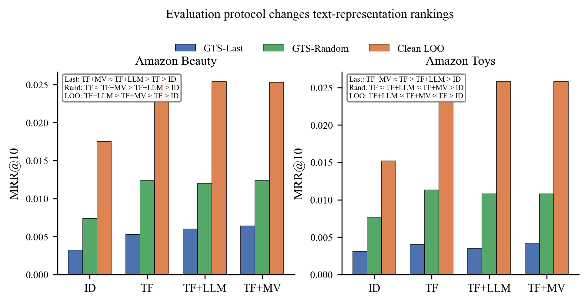
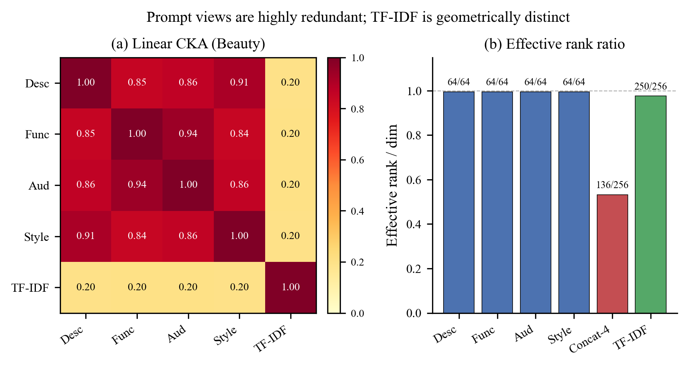

# 0803 老师三件事：对照答复（含表与图）

> 日期：2026-08-06  
> 依据：`0803zhidao.txt` 末段三件事  
> 交互版：Cursor Canvas `0803-three-asks-data-pack.canvas.tsx`

---

## 协议用语（先对齐）

| 术语 | 含义 |
|------|------|
| **GTS-Last / GTS-Random** | 时间切分下，每用户只评 1 个 test target（最后一次 / 随机一次） |
| **warm targets** | 正确答案商品在 **train cutoff 前**已出现过 |
| **train-cutoff 前可用 catalog** | 排名时候选池 = 训练截止前已有商品（不只筛 target） |
| **训练期拟合** | TF-IDF vocab/IDF、SVD、center/whiten 只用训练期 item |
| **Clean LOO** | 仅作协议对照，不承担主结论 |

---

## 第一件事：锁定 Protocol

### 要求 → 我们怎么落

| 老师要求 | 落点 | 状态 |
|----------|------|------|
| 主表 GTS-Last **或** GTS-Random | Last 主表；Random 并列 | Last✅ Random✅（候选 mask 重评进行中） |
| warm targets | 主表报 `*_warm` | ✅ |
| train-cutoff 可用 catalog | 候选限 train catalog | 🔧 脚本已改，重评进行中 |
| TF/SVD/whiten 仅训练期 | `.ts.npy` / `4views_ts` | ✅ |
| All / unseen → Appendix | audit + `_all` 列 | ✅ |
| Clean LOO 只作 contrast | Fig protocol + 下表 | ✅ |

### 表 A｜主表候选：GTS-Last · warm · MRR@10（3-seed mean±std）

| Dataset | ID | TF | LLM | MV | UniSRec |
|---------|---:|---:|----:|---:|--------:|
| Beauty | 0.0032±0.0006 | 0.0051±0.0008 | 0.0059±0.0005 | **0.0061±0.0005** | 0.0052±0.0002 |
| Toys | 0.0031±0.0002 | 0.0040±0.0005 | 0.0035±0.0002 | **0.0042±0.0006** | 0.0041±0.0001 |

源：`gts_last_eval.csv`（30 ckpt）。文本≫ID；TF/LLM/MV 差距贴近 seed 方差。

### 表 A′｜GTS-Random · warm · MRR@10（sample_seed=42）

| Dataset | ID | TF | LLM | MV | UniSRec |
|---------|---:|---:|----:|---:|--------:|
| Beauty | 0.0081±0.0003 | **0.0139±0.0013** | 0.0130±0.0015 | 0.0134±0.0011 | 0.0098±0.0001 |
| Toys | 0.0096±0.0006 | **0.0146±0.0006** | 0.0140±0.0007 | 0.0141±0.0008 | 0.0103±0.0006 |

源：5090 `gts_random_eval.csv`。叙事同向：文本≫ID，无「MV 稳碾 TF」。

### Appendix：unseen audit（为何 All 不进主表）

| Dataset | Test unseen | Catalog turnover | 说明 |
|---------|:-----------:|:----------------:|------|
| Beauty | 27.8% | 23.3% | 无 content-only zero-shot，冷启动不宜主比 |
| Toys | 34.5% | 31.1% | 同上 |

---

## 第二件事：锁定主文数据

### 表 B｜LOO vs GTS 聚合（MRR@10）— LOO 只作 contrast

| Dataset | Protocol | ID | TF | LLM | MV | 排序 |
|---------|----------|---:|---:|----:|---:|------|
| Beauty | GTS-All | 0.0106 | **0.0165** | 0.0161 | 0.0160 | TF ≥ LLM≈MV |
| Beauty | Clean LOO | 0.0175 | 0.0251 | **0.0254** | 0.0253 | LLM≈MV≈TF |
| Toys | GTS-All | 0.0070 | **0.0113** | 0.0107 | 0.0109 | TF > MV≈LLM |
| Toys | Clean LOO | 0.0152 | 0.0247 | **0.0258** | **0.0258** | LLM≈MV≥TF（方差大） |

> GTS-All = 原 Successive-All 训练评测，用于和历史 LOO 对照；**主结论用表 A（Last-warm）**。

**图 1 — Protocol contrast**（`figures/fig_protocol_contrast.png`）

### 表 C｜GTS Main / Early60 · Beauty · 3-seed test MRR@10

| Window | TF | LLM | MV | 排序 |
|--------|---:|----:|---:|------|
| Main (GTS-All) | **0.0165±0.0008** | 0.0161±0.0005 | 0.0160±0.0008 | TF ≥ LLM≈MV |
| Early60 | **0.0053±0.0002** | 0.0049±0.0002 | 0.0052±0.0001 | TF ≥ MV ≥ LLM |

两窗均 TF 最稳；LLM/MV 未稳定超过约 1 std。

### 表 D｜UniSRec external

| 口径 | Beauty | Toys |
|------|-------:|------:|
| **GTS-Last warm（与主表可比）** | 0.0052 | 0.0041 |
| GTS-All 历史离线（附录备查） | 0.0165 | 0.0195 |

不支持「复杂文本方法稳超 TF」。

### 表 E｜Temporal-shift（associated with，非因果）

**分布变化（valid → test）**

| Dataset | Unseen | Head share | Pop. median | New-item ratio |
|---------|--------|------------|-------------|----------------|
| Beauty | 11.3%→17.8% | 63.1%→56.6% | 21→15 | 23.5%→27.3% |
| Toys | 13.0%→21.3% | 60.1%→52.3% | 18→11 | 27.1%→32.8% |

**valid→test relative MRR drop**

| Dataset | Protocol | TF | LLM | MV |
|---------|----------|---:|----:|---:|
| Beauty | GTS | 43.1% | 44.3% | 43.9% |
| Beauty | LOO | 18.5% | 18.1% | 17.7% |
| Toys | GTS | 54.9% | 55.3% | 54.3% |
| Toys | LOO | 20.7% | 18.2% | 15.4% |

### 图 2 — CKA + Effective Rank（主文组合图的表征部分）

`figures/fig_cka_heatmap.png`（LOOV 数字见表 F）

### Appendix（主文不放）

| 材料 | 要点 |
|------|------|
| Warm-only / per-seed | 原始 CSV |
| Unseen audit | 上表 + `warm_target_audit_*.md` |
| **Cross rank transition（negative）** | Improved≈Degraded（TF 47.6/50.9，LLM 49.6/49.2，MV 51.5/47.3）；entropy/margin 方向不一致 → **不作核心机制** |

---

## 第三件事：轻量关键分析

### 表 F｜LOOV 四 view 全量（zero-mask, min5）— 不挑有利 view

| Dataset | Config | MRR@10 | Δ vs Full | Rel. |
|---------|--------|-------:|----------:|-----:|
| Beauty | Full | 0.015906 | — | — |
| Beauty | −Desc | 0.015845 | −0.000061 | 0.4% |
| Beauty | −Func | 0.016018 | +0.000112 | −0.7% |
| Beauty | −Aud | 0.015743 | −0.000163 | 1.0% |
| Beauty | −Style | 0.015564 | −0.000342 | 2.1% |
| Toys | Full | 0.010175 | — | — |
| Toys | −Desc | 0.009982 | −0.000193 | 1.9% |
| Toys | −Func | 0.010067 | −0.000108 | 1.1% |
| Toys | −Aud | 0.010051 | −0.000124 | 1.2% |
| Toys | −Style | 0.010025 | −0.000150 | 1.5% |

### 表 G｜CKA 3 次独立 item 子样本（Beauty, n=3000）摘要

| 类型 | 范围 (mean) |
|------|-------------|
| Inter-view（4 prompt views） | **0.84 – 0.94**（std ≪ 0.01） |
| TF-IDF ↔ 各 LLM view | **≈ 0.20** |
| Toys inter-view / TF↔view | 0.82–0.92 / ≈0.18–0.19 |

源：`cka_subsample_{beauty,toys}.json`

### 表 H｜Effective rank

| Dataset | Repr. | ER / dim | Ratio |
|---------|-------|----------|------:|
| Beauty | concat-4 | 136.1 / 256 | **53.2%** |
| Beauty | TF-IDF | 249.9 / 256 | 97.6% |
| Toys | concat-4 | 141.2 / 256 | **55.2%** |
| Toys | TF-IDF | 251.4 / 256 | 98.2% |

### 表 I｜参数 / 推理成本

| Dataset | ID | TF | LLM | MV-4view | UniSRec | 延迟 |
|---------|---:|---:|----:|---------:|--------:|------|
| Beauty (M) | 67.16 | 67.43 | 67.56 | 67.71 | 67.69 | ~0.02 ms/sample |
| Toys (M) | 86.84 | 87.10 | 87.24 | 87.38 | 87.37 | 同量级 |

MV 相对 TF 仅 +0.28M → 无增益不是「没算够」。

### 明确不做

不扩 4×256、不调 boost、不救 Cross。

---

## 三 RQ 一句话

1. **Protocol**：LOO 抬高绝对值并改变 TF/LLM/MV 点估计排序；主结论用 GTS-Last（或 Random）+ warm。  
2. **Temporal**：Main/Early 均 TF 更稳；valid→test 大跌与 unseen↑/pop↓ 同现（associated with）。  
3. **Why no MV gain**：高 CKA + 低 concat 秩 + 小 LOOV；TF 与 LLM 更互补但当前 MV 未利用。

---

## 文件索引

| 内容 | 路径 |
|------|------|
| 本答复 | `paper_recsys/0803_three_asks_with_tables.md` |
| Canvas | `canvases/0803-three-asks-data-pack.canvas.tsx` |
| 图 1 | `paper_recsys/figures/fig_protocol_contrast.png` |
| 图 2 | `paper_recsys/figures/fig_cka_heatmap.png` |
| Last / Random CSV | `gts_last_eval.csv` / `gts_random_eval.csv` |
| CKA / LOOV / 成本 | `cka_subsample_*.json` / `leave_one_view_out_*.md` / `model_cost_table.csv` |
